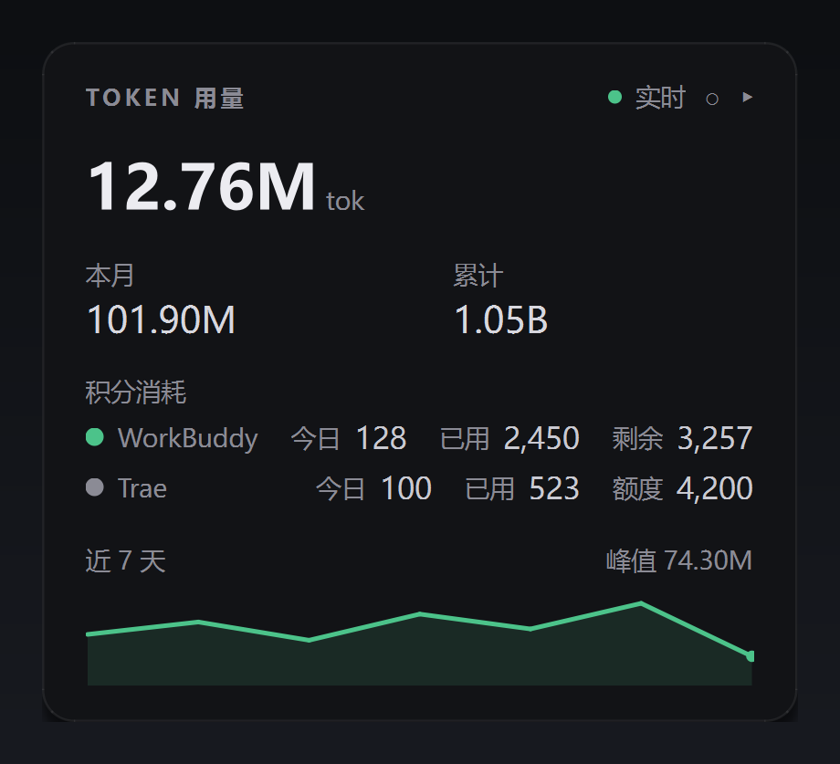
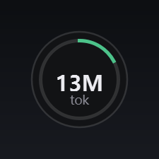
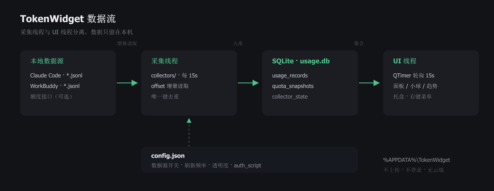

# TokenWidget

一个 Windows 桌面悬浮挂件，用来在本地汇总查看 AI 编程工具的 token 用量与额度消耗。界面走克制的深色仪表盘风格，默认 15 秒刷新一次；可以收起成 58×58 的小球，常驻屏幕角落。

> 纯本地运行：不联网上传任何用量数据，不做账号登录，不读取云端账单以外的信息。

<p align="center">
  
  
</p>

## 功能

- 今日 / 本月 / 累计 token 总量，主数字大号展示
- 近 7 天用量迷你折线趋势
- 积分消耗分组展示（不同来源分列，避免与 token 单位混淆）
- 额度进度条（订阅上限 / 已用 / 剩余）
- 展开查看输入、输出、缓存读明细
- 球形态：收起后只显示今日用量缩写与进度环，点击展开、拖动移动、位置记忆
- 托盘图标、置顶、透明度、开机自启、右键菜单
- 采集与 UI 分线程，多来源可插拔；重复记录按 offset / 唯一键去重

## 运行

仅支持 **Windows 10/11**，需要 Python 3.10+（开发环境为 3.12）。

```powershell
pip install -r requirements.txt
python main.py
```

打包为单文件 exe：

```powershell
pyinstaller TokenWidget.spec
```

产物在 `dist\TokenWidget.exe`（体积较大，因为 PySide6 运行库，约 50MB）。该目录已加入 `.gitignore`，发布时请走 GitHub Releases。

## 数据源

| 来源 | 数据 | 状态 | 说明 |
|---|---|---|---|
| `claude_code` | token | 稳定 | 增量解析 `~/.claude/projects/**/*.jsonl`，按消息 ID 去重 |
| `workbuddy` | token + 积分 | 稳定 | 增量解析 `~/.workbuddy/projects`、`~/.workbuddy-ai/projects` 下的会话日志 |
| `openai_api` | 额度 | 可选 | OpenAI 兼容计费端点，需在配置里填 `api_key` |
| `oneapi` | 额度 | 可选 | one-api / new-api 网关，需填 `base_url` 与 `access_token` |
| `workbuddy_quota` | 积分额度 | **实验性** | 读取本机登录态查询官方账单接口 |
| `trae_api` / `trae` | 积分额度 | **实验性** | 依赖 Trae 调试端口或主进程注入钩子 |

### 关于实验性模块

以下脚本与采集器涉及**第三方客户端内部实现或本机凭证**，默认不保证可用，请自行评估合规风险后再使用，仓库作者不对使用后果负责：

- `collectors/trae_api.py`：读取 `~/.trae-cn/trae-jwt-token` 并通过调试端口代发请求
- `collectors/workbuddy_quota.py`：需要用户在 `config.json` 的 `sources.workbuddy_quota.auth_script` 里指定本地脚本（该脚本需提供 `load_token_best()` 与 `api_call()`），留空则自动跳过额度采集
- `trae_hook.py`、`trae_boot_marker.py`：改写第三方客户端 `main.js` 注入埋点，**属于高风险操作，仅建议在自己可控的机器上手工执行**，可用 `python trae_hook.py restore` 还原
- `launch-trae-debug.cmd`：以 `--inspect=9229` 启动 Trae；部分版本启动器会剥离该参数，届时脚本会提示失败

如果你只需要 Claude Code / WorkBuddy 的本地日志统计，把 `config.json` 里对应来源之外的 `enabled` 全部改成 `false` 即可，功能不受影响。

## 架构

<p align="center">
  
</p>

采集线程按 `collect_seconds` 周期运行各采集器，只负责增量读取与入库；UI 线程用独立的 `QTimer` 查询聚合结果，两者互不阻塞。

## 配置

首次运行会在 `%APPDATA%\TokenWidget\` 生成：

| 文件 | 用途 |
|---|---|
| `config.json` | 数据源开关、刷新频率、界面透明度与位置等 |
| `prices.json` | 模型价格表（美元 / 1M tokens），可自行修正 |
| `usage.db` | SQLite 用量与额度快照 |
| `error.log` | 采集异常日志（采集线程无 stderr，异常统一写文件） |

配置示例（节选）：

```json
{
  "sources": {
    "claude_code": { "enabled": true, "log_dir": "~/.claude/projects" },
    "workbuddy":   { "enabled": true, "log_dirs": ["~/.workbuddy/projects"] },
    "workbuddy_quota": { "enabled": true, "interval_seconds": 180, "auth_script": "" },
    "openai_api":  { "enabled": false, "base_url": "https://api.openai.com/v1", "api_key": "" },
    "oneapi":      { "enabled": false, "base_url": "http://localhost:3000", "access_token": "" }
  },
  "ui": { "opacity": 0.8, "always_on_top": true, "refresh_seconds": 15, "ball_mode": false },
  "collect_seconds": 15
}
```

界面操作：左键拖动移动，单击小球展开，右键菜单可切换球形态、置顶、透明度、开机自启、退出。

## 项目结构

```
token-widget/
├─ main.py              # 入口：存储初始化 → 采集线程 → 悬浮窗
├─ widget.py            # PySide6 悬浮窗 / 小球 / 托盘 / 右键菜单
├─ storage.py           # SQLite 存储与聚合
├─ config.py            # 配置读写、开机自启
├─ pricing.py           # 模型价格匹配与费用估算
├─ prices.json          # 内置价格表（首次运行复制到用户目录）
├─ collectors/          # 可插拔采集器
│  ├─ claude_code.py
│  ├─ workbuddy.py
│  ├─ workbuddy_quota.py
│  ├─ trae_api.py
│  ├─ trae_manual.py
│  ├─ openai_api.py
│  └─ oneapi.py
├─ trae_hook.py         # 实验性：主进程注入（可还原）
├─ trae_boot_marker.py  # 实验性：启动标记
├─ TokenWidget.spec     # PyInstaller 打包配置
├─ docs/                # README 截图与数据流图
└─ requirements.txt
```

## 隐私说明

- 所有采集结果只写入本机 `%APPDATA%\TokenWidget\usage.db`，不发起任何上报请求
- 除用户在配置里主动填写的 `api_key` / `access_token` 外，程序不读取任何明文凭证；实验性模块仅在本机内复用已有登录态
- `quota_snapshots.raw` 与 `usage_records.raw` 会保留上游响应的截断片段，便于排查字段变更，不包含密钥；如需最小化留存可自行清空

## 免责声明

本项目为个人非官方工具，与 Trae、WorkBuddy、Anthropic、OpenAI 等公司无任何关联，相关名称与商标归各自所有者。价格表仅为估算参考，不代表官方账单。使用实验性采集模块可能违反第三方软件的服务条款，请自行判断并承担风险。

## License

[MIT](LICENSE)
